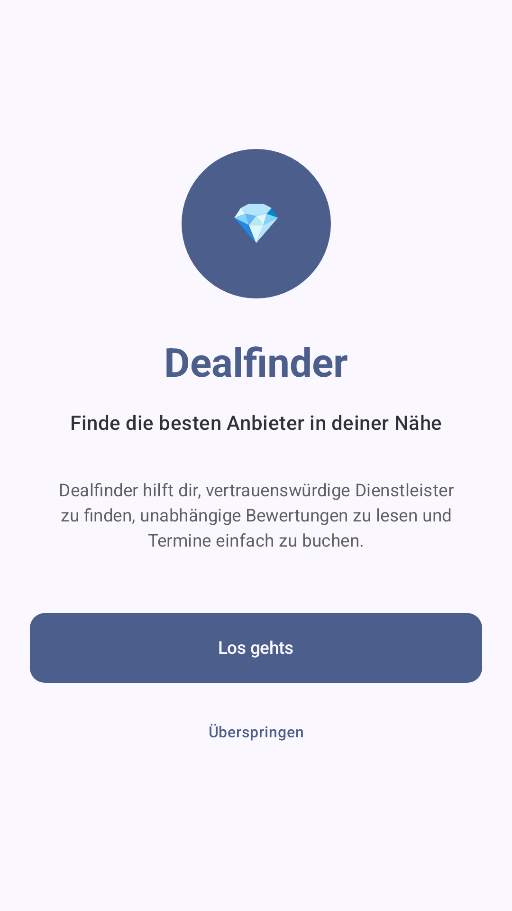
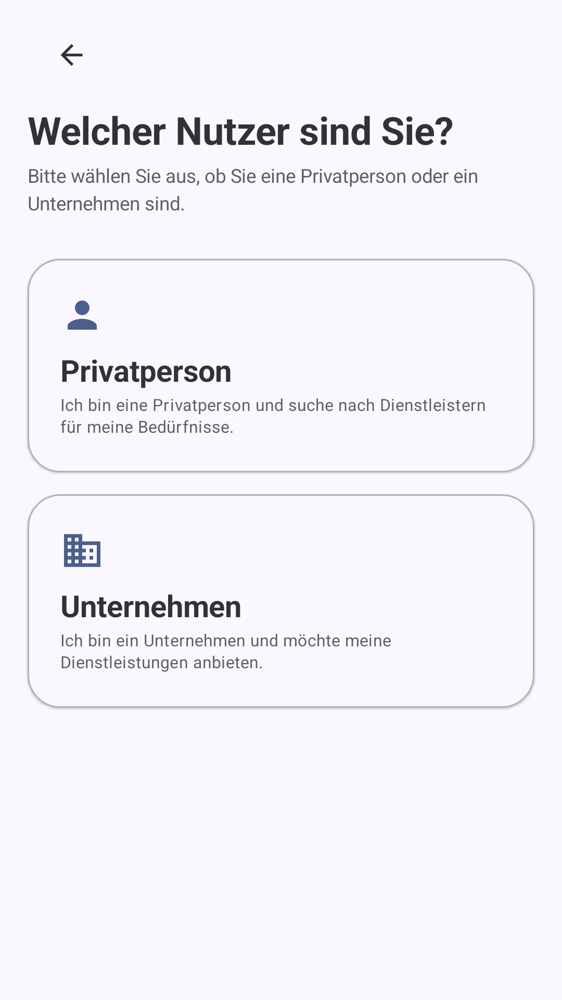

# Dealfinder

Dealfinder ist ein Android-Prototyp, mit dem Privatpersonen passende Dienstleister in ihrer Nähe finden, Angebote vergleichen und Termine direkt buchen können. Unternehmen können ihre Dienstleistungen präsentieren. Die Anwendung verwendet ausschließlich fiktive Demodaten.

## Funktionen

- Suche nach Dienstleistung, Aktivität und Standort – optional mit dem eigenen Standort
- Kategorien, Empfehlungen und zeitlich begrenzte Sonderangebote
- Anbieterprofile mit Bewertungen und Favoriten
- Geführter Buchungsprozess für Dienstleistungen, Datum und Uhrzeit
- Registrierung für Privatpersonen und Unternehmen
- Verwaltung eigener Buchungen, Angebote und Einstellungen

## Screenshots

<p align="center">
  
  
</p>

Die Abbildungen wurden direkt aus den Compose-Previews gerendert; dafür wurde kein Android-Emulator gestartet.

## Technik

- Kotlin und Jetpack Compose mit Material 3
- Navigation Compose und ViewModels
- Room für die lokale Datenhaltung
- DataStore für App- und Sitzungspräferenzen
- Google Play Services Location für die optionale Standortsuche
- Coil für das Laden von Bildern

## Lokales Bauen

Voraussetzung ist ein Android-SDK mit API-Level 37.

```bash
./gradlew assembleDebug
```

## Status

Dealfinder ist ein Prototyp. Anbieter, Bewertungen, Angebote und Buchungen sind Beispieldaten.
